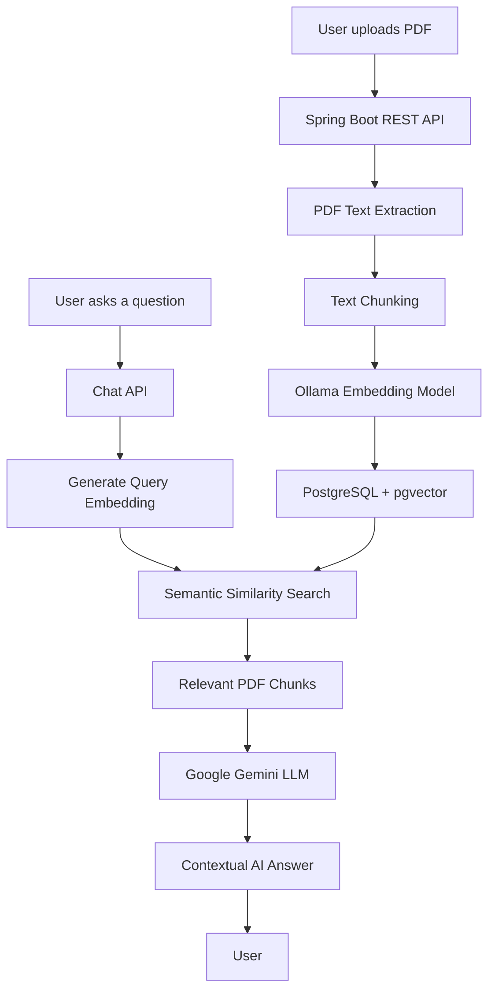

# 📄 PDF Chatbot using RAG

<p align="center">
  <b>Chat with your PDF documents using AI.</b><br/>
  Upload a PDF, ask questions, and get intelligent, context-aware answers powered by Retrieval-Augmented Generation.
</p>

---

## 🚀 Overview

**PDF Chatbot** is an AI-powered application built using Java, Spring Boot, and Spring AI. It uses **Retrieval-Augmented Generation (RAG)** to answer questions based on the content of uploaded PDF documents.

Instead of relying only on an LLM's pre-trained knowledge, the application retrieves relevant information from your PDF and provides it as context to the AI model.

## ✨ Features

- 📤 **PDF Upload** – Upload PDF documents through a REST API.
- ✂️ **Text Chunking** – Split extracted PDF content into smaller chunks.
- 🧠 **Vector Embeddings** – Generate embeddings using Ollama's `nomic-embed-text`.
- 🗄️ **Vector Storage** – Store and search embeddings using PostgreSQL with pgvector.
- 🔍 **Semantic Search** – Retrieve relevant chunks based on question meaning.
- 🤖 **AI-Powered Answers** – Generate contextual responses using Google Gemini.
- 📚 **Document-Specific Search** – Retrieve information from a selected PDF using document ID.
- 💬 **Conversation History** – Persist chat messages and maintain conversation context.

## 🏗️ Architecture



## 🛠️ Tech Stack

| Technology | Purpose |
|---|---|
| Java 17 | Backend programming |
| Spring Boot | REST API and application development |
| Spring AI | AI model integration and RAG workflow |
| Google Gemini | LLM for answer generation |
| Ollama | Local embedding model runtime |
| nomic-embed-text | Text embedding generation |
| PostgreSQL | Relational database |
| pgvector | Vector storage and similarity search |
| Spring Data JPA | Conversation history persistence |
| Maven | Dependency management |

## ⚙️ How It Works

### 1. Document Ingestion

1. User uploads a PDF.
2. Spring AI extracts text from the PDF.
3. Extracted text is divided into smaller chunks.
4. Ollama generates vector embeddings for each chunk.
5. Embeddings and metadata are stored in PostgreSQL using pgvector.

### 2. Question Answering

1. User submits a question along with the document ID.
2. The question is converted into an embedding.
3. pgvector performs semantic similarity search.
4. The most relevant PDF chunks are retrieved.
5. Retrieved content is passed to Google Gemini as context.
6. Gemini generates an answer based on the retrieved information.
7. Conversation messages are persisted in PostgreSQL.

## 🔄 RAG Workflow

**RAG = Retrieval + Augmentation + Generation**

- **Retrieval:** Find relevant information from stored PDF embeddings.
- **Augmentation:** Add retrieved information to the LLM prompt as context.
- **Generation:** Generate an answer using Google Gemini.

## 📁 Project Structure

```text
src/main/java/com/rag/chatbot/
│
├── config/
│   └── ChatConfig.java
│
├── controller/
│   ├── DocumentController.java
│   ├── ChatController.java
│   └── ConversationController.java
│
├── dto/
│   ├── DocumentUploadResponse.java
│   ├── ChatRequest.java
│   ├── ChatResponse.java
│   ├── ChatAnswerResponse.java
│   ├── SourceReference.java
│   └── ConversationResponse.java
│
├── entity/
│   └── ChatMessage.java
│
├── repository/
│   └── ChatMessageRepository.java
│
├── service/
│   ├── DocumentService.java
│   ├── PdfProcessingService.java
│   ├── ChunkingService.java
│   ├── EmbeddingService.java
│   ├── VectorStoreService.java
│   ├── RetrievalService.java
│   ├── ChatService.java
│   └── ConversationService.java
│
└── ChatbotApplication.java
```

## 🔧 Getting Started

### Prerequisites

- Java 17+
- Maven
- PostgreSQL
- pgvector extension
- Ollama
- Google Gemini API key

### 1. Clone the Repository

```bash
git clone https://github.com/yamanrajsingh/PDF-Chatbot-using-RAG.git

cd PDF-Chatbot-using-RAG
```

### 2. Configure PostgreSQL

Create the database:

```sql
CREATE DATABASE rag_chatbot;
```

Connect to the database and enable pgvector:

```sql
CREATE EXTENSION IF NOT EXISTS vector;
```

### 3. Install and Run Ollama

Download Ollama from:

https://ollama.com/

Pull the embedding model:

```bash
ollama pull nomic-embed-text
```

Ensure Ollama is running at:

```text
http://localhost:11434
```

### 4. Configure Environment Variables

Set the following environment variables:

```properties
GEMINI_API_KEY=your_gemini_api_key
DB_PASSWORD=your_postgresql_password
```

Configure your `application.properties`:

```properties
spring.application.name=chatbot

spring.ai.google.genai.api-key=${GEMINI_API_KEY}
spring.ai.google.genai.chat.model=YOUR_GEMINI_MODEL

spring.ai.ollama.base-url=http://localhost:11434
spring.ai.ollama.embedding.options.model=nomic-embed-text

spring.datasource.url=jdbc:postgresql://localhost:5432/rag_chatbot
spring.datasource.username=postgres
spring.datasource.password=${DB_PASSWORD}

spring.ai.vectorstore.pgvector.initialize-schema=true
spring.ai.vectorstore.pgvector.dimensions=768
spring.ai.vectorstore.pgvector.distance-type=COSINE_DISTANCE

spring.servlet.multipart.max-file-size=50MB
spring.servlet.multipart.max-request-size=50MB

spring.jpa.hibernate.ddl-auto=update
```

Replace `YOUR_GEMINI_MODEL` with the Gemini model configured and supported in your environment.

### 5. Run the Application

Using Maven:

```bash
mvn spring-boot:run
```

Or run `ChatbotApplication.java` from your IDE.

## 🔗 API Endpoints

| Method | Endpoint | Description |
|---|---|---|
| POST | `/api/documents/upload` | Upload and process a PDF |
| POST | `/api/chat/ask` | Ask questions about a PDF |
| POST | `/api/chat/retrieve` | Retrieve relevant document chunks |
| POST | `/api/chat/conversations` | Create a conversation |

*Conversation history and deletion endpoints depend on the corresponding controller implementation.*

### Upload PDF

**POST** `/api/documents/upload`

Request: `multipart/form-data`

| Key | Type |
|---|---|
| file | PDF file |

### Ask a Question

**POST** `/api/chat/ask`

Request body:

```json
{
  "question": "Explain the main topic of this document",
  "documentId": "YOUR_DOCUMENT_UUID",
  "conversationId": "YOUR_CONVERSATION_UUID"
}
```

## 🧠 Key Concepts Implemented

- Retrieval-Augmented Generation (RAG)
- Text Embeddings
- Token-Based Chunking
- Vector Databases
- Cosine Similarity Search
- Top-K Retrieval
- Metadata Filtering
- Prompt Engineering
- LLM Context Augmentation
- Conversation Memory
- Semantic Search

## 🔮 Future Enhancements

- [ ] Source citations with PDF page numbers
- [ ] Streaming AI responses using Server-Sent Events
- [ ] Hybrid Search (Vector + Keyword)
- [ ] Reranking retrieved chunks
- [ ] Query Rewriting for conversational questions
- [ ] Document management and deletion
- [ ] JWT Authentication and authorization
- [ ] Asynchronous PDF processing

## 👨‍💻 Author

**Yaman Raj Singh**

Java Backend Developer | AI Backend Engineer

- GitHub: [@yamanrajsingh](https://github.com/yamanrajsingh)

---

<p align="center">
  ⭐ If you find this project useful, consider giving it a star!
  <br/><br/>
  <b>Built with Java, Spring AI & RAG ❤️</b>
</p>
